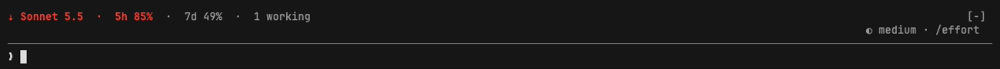
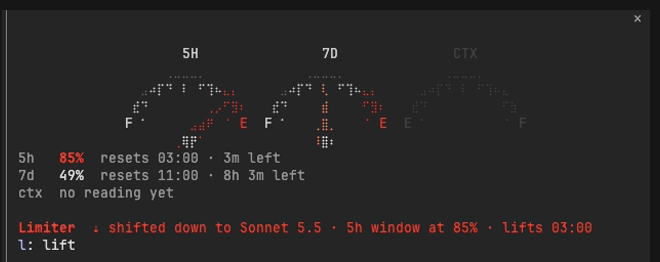

# redline

A rev limiter for Claude Code. Set a redline on your plan's five-hour and seven-day windows; past it, every request this session makes goes out on Sonnet, or at low effort, until the window resets. It never stops you working, it stops you spending the last of a window at Opus prices on the easy parts. One dim line above the prompt shows the two windows, the context, and which of your other sessions are waiting on you.

```
5h 62%  ·  7d 31%  ·  ctx 44%  ·  1 session needs you  ·  2 working
```

Shifted down, the line leads with the gear:

```
⇣ Sonnet 5.5  ·  5h 84%  ·  7d 31%  ·  ctx 44%  ·  2 working
```



## Install

Add the marketplace:

```
/plugin marketplace add jamubc/toolbox
```

Install the plugin:

```
/plugin install redline@toolbox
```

## Usage

| Command | What it does |
| --- | --- |
| `/redline` | Opens and closes the dash: the three dials, the readouts, the limiter and every session. |
| `/redline shift` | Shifts down now, until the five-hour window resets. |
| `/redline lift` | Lifts the limiter until the five-hour window resets, when you need the big model past the redline. |
| `/redline auto` | Hands the lever back to the limiter. |

The dash, opened with `/redline`:



As text:

```
        ⡴⠋⠉⠉⠳⡄    ⡴⠋⠉⠉⠳⡄    ⡴⠋⠉⠉⠳⡄
       ⣇⠀⠀5H⠀⠀⣸   ⣇⠀⠀7D⠀⠀⣸   ⣇⠀⠀CTX⠀⣸
       F   ⠈⠁  E   F   ⠈⠁  E   E   ⠈⠁  F

 5h   62%  resets 20:00 · 4h left · runs out 19:10 at this pace
 7d   31%  resets Thu 09:00 · 2d 3h left
 ctx  44%  $1.20 this session

 Limiter  in gear · shifts at 80% of 5h, 90% of 7d
 shift now

 Sessions  3
 ! fennec    needs you · approve Bash · 2m · ctx 61% · $0.40
 ● toolbox   working · 4m · ctx 44% · $1.20 · this one
 ○ jam       idle
```

On the plan dials the needle swings from F to E as the window drains and turns red in the reserve; the context dial fills, E to F. The plan readings need a subscription; the context works for everyone. A dial the engine has no reading for stays dim.

## Settings

`/config`, or the plugin's settings:

| Setting | Default | What it does |
| --- | --- | --- |
| Shift down when the 5-hour window is this % used | 80 | The redline on the five-hour window. |
| Shift down when the 7-day window is this % used | 90 | The redline on the seven-day window. |
| What shifting down does | switch to Sonnet | `switch to Sonnet` sends requests to the model below instead of the session's model, subagents too. `lower effort` sets the effort to low. `Sonnet and lower effort` does both. `warn only` changes nothing and just shows the line. |
| The model to shift down to | claude-sonnet-5-5 | A full model id, as `/model` lists it; Claude Code takes an id here, not an alias. Haiku works too. |
| The line above the prompt | one line, always | `only when it matters` keeps the line blank until the limiter shifts, a session needs you, or a window is within twenty points of its redline. `never` draws nothing above the prompt; `/redline` still opens the dash. |

A request already on Sonnet or Haiku, or on the model you chose, is left alone. The limiter lifts itself when the window resets, and says so in a toast each time it shifts or lifts.

## Sessions

Every Claude Code session on this machine with redline installed writes a small heartbeat; the dash reads them all, so it can say exactly what a session is waiting for: a permission prompt, with the tool's name, or a question. A permission prompt counts once it has stayed open for three seconds, so the auto-mode classifier, which answers in about one, never makes a session look like it needs you. A session without redline still appears, from Claude Code's own list of running sessions, as working or idle. In the line above the prompt only the sessions that need you, and the count working, are shown.

## What it runs, reads and sends

redline runs one read-only program on your machine and sends nothing anywhere. It makes no network requests.

| Program | Exactly what it runs | When | Why |
| --- | --- | --- | --- |
| `claude` | `claude agents --json` | Every five seconds, in an interactive session only | Claude Code's own list of your running sessions: each one's id, working directory, name and whether it is busy or idle. |

- It reads this session's usage (`session.usage` at start and the `session.measure` event after each turn): the context fill, your plan's rate-limit percentages and reset times, and the session's cost, the same figures the status line has. The limiter decides from them and the dash draws them.
- It writes a heartbeat for this session to its plugin store, a JSON file under `~/.claude/plugins/store/` that every session on this machine shares: the session id, working directory, state (working, waiting or idle) and what it waits for, when that changed, the turn count, the context fill, the cost so far, the model, and whether the limiter is shifted. It is written at start, on every change of state, and every thirty seconds, and removed when the session ends. It reads the other sessions' heartbeats every five seconds; one older than a day is removed.
- It hooks `turn.step` to change the model, or the effort, of a request while shifted, and `agent.spawn` to send a subagent to the same model while shifted. In gear it passes both through unchanged.
- It hooks `tool.check` only to read the decision: when a tool is going to ask and the answer takes more than three seconds, the heartbeat says so. It never changes a decision. It hooks `tool.call` to notice `AskUserQuestion` and to clear the waiting state once the call goes through.
- It hooks `command.run` only for its own `/redline` command, `ui.close` to notice when you close its pane, and `session.start`, `session.end` and `session.measure` to keep its figures right across `/clear`.
- It never starts, stops or changes another process. The session list is read, parsed in memory and dropped.
